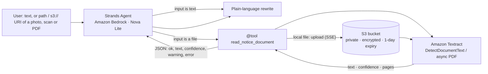

# Architecture

Editable draw.io version (AWS icons, numbered steps): [architecture.drawio](architecture.drawio). Open it at app.diagrams.net or in draw.io desktop.

**Decision point.** The model chooses whether to call the tool from the tool's docstring alone.
No router code, no regex: the agent loop is unchanged.

**Failure paths** (all returned as `ok:false` JSON so the agent can tell the user instead of guessing):
unsupported type, missing file, oversize file, missing bucket, Textract rejection, PDF job failure,
PDF timeout. Low mean confidence returns `ok:true` with `low_confidence` and a warning.
